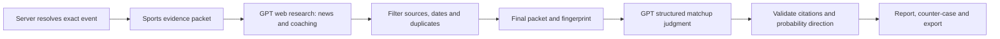

# GPT matchup research: packet design and implementation

Oracular now answers two separate questions: **which side has the stronger sports case, and does the available price support further market research?** GPT reviews an inspectable evidence packet. It does not replace the baseline, fabricate missing data, or turn a likely winner into an automatic bet.

## Why the packet comes first

A sports prediction can look persuasive while using the wrong season, a stale injury report, an unconfirmed starting lineup, or information published after the event. Research on deployable sports models emphasizes when inputs become available and whether evaluation reflects real future use. Oracular therefore records event state, retrieval times, publication times when available, sample scope, missing fields, and the precise evidence supplied to the model. A future improvement is immutable pre-event storage and prospective calibration; this implementation does not claim a backtested edge. See the [task-specific systematic review](https://www.frontiersin.org/journals/physiology/articles/10.3389/fphys.2026.1920214/full) and [review of team-sport prediction research](https://arxiv.org/abs/1912.11762).

The NBA distinguishes pace from possession-adjusted ratings; raw scoring averages remain separate from efficiency measures. [NBA glossary](https://www.nba.com/stats/help/glossary)

MLB's xwOBA uses contact-quality inputs; Oracular requires sourced values rather than inferring them from ordinary box-score totals. [MLB glossary](https://www.mlb.com/glossary/statcast/expected-woba)

## Implemented workflow

1. The browser sends only league, event ID and slate date. It cannot supply a prompt, player facts, odds, or a fabricated evidence packet.
2. The server resolves the event from the sports feed. It assembles the current scoreboard, independent baseline, matchup summary, player leaders, injury entries, rosters, correctly scoped team statistics, schedules, relevant news and available prices.
3. A bounded OpenAI Responses request uses hosted web search to investigate both teams' coaching backgrounds, current availability, recent reporting and relevant venue context. This stage collects findings, not predictions.
4. Each web finding must cite a URL actually returned by the search tool, on an approved source domain. News and availability claims also need a valid publication date within seven days and no later than the packet cutoff. Future, stale, undated current-status and unsupported-source findings are discarded. Coaching biography can be undated, but cannot establish a recent change without dated evidence.
5. The server appends accepted findings with evidence/source identifiers. The second GPT request receives the full packet and no browsing tools. It produces a structured sports judgment, overview sections, factors, a counter-case, risks, view-changing conditions and a market watch/pass assessment.
6. The server checks evidence IDs, factor citations, probability direction and conservative market/confidence constraints. An invalid judgment fails visibly rather than being displayed as a supported recommendation.

OpenAI's [web search documentation](https://developers.openai.com/api/docs/guides/tools-web-search) describes retrieved sources and citations; the UI exposes supporting links next to analysis sections and in the packet inspector. [Structured Outputs](https://developers.openai.com/api/docs/guides/structured-outputs) constrains response shape. Schema compliance alone does not establish factual correctness, so application validation remains necessary.

## Packet inventory

| Section | Supplied evidence | Interpretation and limits |
| --- | --- | --- |
| Matchup overview | Exact event ID; league; home/away identities; venue; start time; competition phase; neutral site; score, period and clock; season records | A live snapshot is distinct from a pregame view. Finished events are review-only. |
| Player overview | Matchup leaders; provider game statistics; season roster; position; age/experience when supplied; roster status; reported injuries | Roster-active does not mean cleared, starting, or expected to play a specific number of minutes. Rosters are capped and report included/listed counts. |
| Availability | Injury name, status and report date; dated web updates; explicitly missing lineup information | Do not invent injury severity, replacement value or numerical probability adjustments. Conflicting or absent reports lower conviction. |
| Team statistics | Scoreboard scoring profiles, provider matchup comparison, season/phase-validated statistic values and labels | Incorrect-season statistics are excluded. Provider comparison scopes may differ and are labeled. No synthetic advanced metrics are presented as provider data. |
| Form and schedule | Up to five completed games before the event/snapshot cutoff; opponent, score, location role and competition phase; next scheduled game; hours between game starts | This is not opponent-adjusted form, exact recovery time, measured fatigue or a travel-distance model. |
| News overview | Relevant team/player article headline and description; dated, cited web findings | Team-feed filtering can be loose, so the server checks team/athlete categories or full team-name relevance. Headline descriptions are labeled as such; syndicated repetition is not independent corroboration. |
| Coach background | Coaching identity listed on the target-season roster; researched tenure, prior roles, scheme and recent changes when supported | Do not assume a famous coach improves win probability by a fixed amount, or treat career wins as a causal matchup advantage. Missing background remains missing. |
| Tournament context | Competition labels, season phase, venue and neutral-site status; sport-specific tournament checklist | Motivation and seeding stories require evidence. This is not a championship simulation or a bracket model. |
| Environment | Venue from the feed; relevant sourced weather/venue findings from web research | No dedicated weather forecast provider is configured. Do not infer outdoor effects without evidence or apply them to an indoor venue. |
| Markets | Available two-outcome moneylines, source and quote timestamps, margin-normalized probabilities, freshness and execution caveats | Prices do not enter the baseline. Stale/unverified prices cannot support an executable edge. GPT supplies watch/pass, not staking or execution instructions. |

## Sport-specific research priorities

- **NBA:** primary creators and projected minutes, rotation availability, possession-adjusted offense/defense, pace, three-point variance, turnovers, offensive rebounding, schedule spacing.
- **NCAA men's basketball:** strength of schedule and opponent-adjusted efficiency, roster continuity, coach scheme, foul/depth risk, neutral courts and single-elimination variance.
- **NFL:** starting quarterback and offensive line, play-caller changes, sourced EPA/success/pressure measures, rest, outdoor wind/weather, tie and settlement conventions.
- **MLB:** confirmed starting pitcher, handedness and lineup, bullpen workload, park/weather, defense and platoon context, sourced K–BB%, xwOBA or xERA with sample size.
- **NHL:** confirmed goalie, workload, line availability, sourced five-on-five shot quality/xG, special teams, travel/rest and overtime conventions.

These are checklists, not a claim that every listed metric is available. Unsupported fields become gaps. The model is explicitly instructed not to fill them from memory.

## Evidence contract and reproducibility

`sportsdesk.matchup.v1` contains the resolved game, independent baseline, `E###` evidence records, `S###` source records, coverage counts, gaps, sport checklist, quotes and web-research status. Every evidence record includes category, team side, data, source ID, observation time, publication time if known, and scope. Provider retrieval time is not advertised as an official update time.

The report includes the exact final packet, SHA-256 packet fingerprint, model, generation time, prompt version, token usage and reported web-tool-call count. Both the packet and full report can be exported. They are snapshots; they are not automatically graded historical predictions or a permanent server audit database. A packet preview is free of OpenAI calls and can differ from the fresh packet assembled when the user runs analysis.

**Important boundary:** checking that a citation was returned by search is provenance validation, not independent proof that the page entails every extracted statement. Web summaries remain GPT-extracted claims. Publication dates for web findings are model-extracted and can be wrong. Sources without known provider update times are explicitly limited. The system cannot reconstruct historical point-in-time inputs from today's mutable feeds, so it refuses retrospective GPT predictions. If a pregame event starts during research, analysis asks the user to refresh for a live snapshot.

## Judgment contract

The report includes:

- `lean_home`, `lean_away`, or `no_lean`; a subjective home probability or null; qualitative conviction.
- Separate matchup, player, news and coaching overviews, with evidence IDs and uncertainty.
- Cited drivers, the strongest counter-case, risks and concrete conditions that would change the view.
- A market `watch` or `pass` conclusion and explanation.

Probabilities are subjective and uncalibrated. They do not overwrite the statistical baseline or the dashboard's verified price-signal calculation. Unknown citation IDs, uncited drivers and contradictory probability direction are rejected. `no_lean` removes the numeric probability. Limited baseline/player coverage or failed web enrichment prevents high conviction. Preseason and lack of fresh prices force a market pass.

## Runtime and credentials

- `OPENAI_API_KEY`: required only for live GPT analysis; server-side, never a `NEXT_PUBLIC_` variable.
- `OPENAI_MODEL`: optional; default `gpt-6.1-sol`. The default was verified against current official model documentation and the provider registry. See [model capabilities](https://developers.openai.com/api/docs/models/gpt-6.1-sol).
- `ODDS_API_KEY`: still optional for timestamped bookmaker odds; it is not required to run GPT research.

The integration uses `@ai-sdk/openai` directly because this deployment is configured with an OpenAI API key. It does not require AI Gateway credentials. Both requests use Responses with `store: false`; research uses bounded web search and low reasoning effort, judgment uses medium effort. Outputs and input sizes are bounded, automatic model-request retries are disabled, and the model phase has a 150-second timeout. The route allows 240 seconds including sports-data collection and emits real progress stages and connection heartbeats.

Completed reports are cached in the framework data cache with five-minute pregame buckets and one-minute live buckets keyed by event state and score. A per-process in-flight map deduplicates concurrent identical requests and limits concurrency to three jobs. This is not a distributed rate limiter or a global spending cap. The platform remains accessible without authentication. Analysis runs only after an explicit user action; opening a packet or browsing the slate does not call OpenAI. Provider failures and missing configuration remain visible.

## Validation and next evaluation work

Regression checks cover wrong-season rejection, relevance filtering, completed/future-game exclusion, source-domain spoofing, missing/stale/future citation dates, duplicate findings, evidence-ID validation, probability consistency, missing-data constraints, retrospective blocking, strict API inputs, streamed UI results, report exports and error/retry behavior.

For predictive evaluation, collect immutable pre-event packets and forecasts, separate development and future evaluation windows, evaluate calibration/Brier/log loss against simple and market baselines, and include realistic spreads, costs and settlement conventions. Compare evidence-only and market-aware analyses in controlled experiments to measure market anchoring and correlated evidence. Evaluate coach/news/player claims for factual support separately from outcome prediction. None of these prospective performance claims is made by the current feature.
